<div align="center">

# 📦 ipa-builder

### Build unsigned iOS `.ipa` files in the cloud — no Mac, no $99/year Apple account.

*[Leer en español →](README.es.md)*

[](.github/workflows/build-ipa.yml)
[](#-how-it-works)
[](#-requirements)
[](#-how-it-works)
[](LICENSE)

</div>

---

## The problem

You built an iOS app with Expo or React Native. You want it on your own
iPhone. Apple's answer: buy a Mac, or pay **$99/year** for a developer
account — just to install your own app on your own device.

Sideloadly and AltStore solve the *signing* half of that for free, using
your everyday Apple ID. But they still need a compiled `.ipa` to sign, and
compiling an iOS app has always meant Xcode, which has always meant a Mac.

**`ipa-builder` removes the Mac.** It compiles your `.ipa` on GitHub's free
macOS runners — no local Xcode, no Apple Developer Program, no signing step
on your side at all.

<div align="center">

| Without ipa-builder | With ipa-builder |
|---|---|
| 🖥️ Own or rent a Mac | ☁️ GitHub Actions macOS runner |
| 💳 $99/year Apple Developer account | 🆓 Free Apple ID (via Sideloadly/AltStore) |
| 🛠️ Install & configure Xcode | ⚡ `gh workflow run` and wait ~10-15 min |

</div>

---

## ⚙️ How it works

The whole pipeline is one `workflow_dispatch` job — you trigger it, it checks
out *your* app in a separate repo, builds it unsigned, and hands you back an
artifact.

```mermaid
flowchart LR
    A["👤 You\ngh workflow run"] --> B["🔀 GitHub Actions\nworkflow_dispatch"]
    B --> C["📥 Checkout target repo\n(cross-repo token)"]
    C --> D["🍎 macOS runner\nselect Xcode"]
    D --> E["📦 npm install\nexpo prebuild\npod install"]
    E --> F["🔨 xcodebuild\nCODE_SIGNING_ALLOWED=NO"]
    F --> G["🗜️ Package .ipa\n(unsigned)"]
    G --> H["⬆️ Upload artifact\n14-day retention"]
    H --> I["📲 Sideloadly / AltStore\nsigns with your free Apple ID"]
    I --> J["✅ On your iPhone"]

    style A fill:#1f2937,stroke:#4b5563,color:#fff
    style B fill:#2088FF,stroke:#0969da,color:#fff
    style D fill:#000000,stroke:#4b5563,color:#fff
    style F fill:#147EFB,stroke:#0969da,color:#fff
    style I fill:#3DA639,stroke:#2c7a2c,color:#fff
    style J fill:#1f2937,stroke:#4b5563,color:#fff
```



Every build step runs the real toolchain — `npx expo prebuild`, CocoaPods,
`xcodebuild` with code signing explicitly disabled — so what comes out is a
genuine unsigned build artifact, not a workaround. The full job definition
is one readable file: [`.github/workflows/build-ipa.yml`](.github/workflows/build-ipa.yml).

---

## 📋 Requirements

- A GitHub account with the [`gh` CLI](https://cli.github.com/) installed and authenticated (`gh auth login`).
- An Expo/React Native project in a GitHub repo (yours or one you have access to), with `app.json` configured (`ios.bundleIdentifier` set).
- This repo (or your fork of it).
- On the phone: [Sideloadly](https://sideloadly.io/) or [AltStore](https://altstore.io/) to sign and install the `.ipa` with a free Apple ID.

The default runner is `macos-latest` (macOS 26, Apple silicon, Xcode 26.x), so projects that need the **iOS 26 SDK** build out of the box. Set the `runner` input to `xcode-27` for macOS 27 with Xcode 27 and the **iOS 27 SDK** (a GitHub preview image, so expect occasional queueing).

## 🔑 One-time setup

### 1. `CROSS_REPO_TOKEN` (needed for private app repos)

The workflow needs permission to read the repo you want to build (even if
private) using its own token. The default `GITHUB_TOKEN` only has access to
the repo the workflow itself lives in. For a public app repo you can skip this.

1. Go to [github.com/settings/tokens?type=beta](https://github.com/settings/tokens?type=beta) → **Generate new token** (fine-grained).
2. Name it, e.g. `ipa-builder-checkout`.
3. Under **Repository access** → **Only select repositories**, check the repos you want to build.
4. Under **Permissions → Repository permissions**, set **Contents: Read-only**. Nothing else needed.
5. Generate the token and copy it (shown once).
6. In your terminal:

   ```bash
   gh secret set CROSS_REPO_TOKEN --repo YOUR-USERNAME/ipa-builder
   ```

### 2. `IPA_PASSPHRASE` (recommended if this repo is public)

Workflow logs of a **public** repository are public, and any signed-in GitHub user can download a public repository's artifacts. If the app you build is private, either make `ipa-builder` private or set a passphrase so the `.ipa` and the build log are encrypted (AES-256, PBKDF2) before upload:

```bash
gh secret set IPA_PASSPHRASE --repo YOUR-USERNAME/ipa-builder
```

Decrypt after downloading:

```bash
openssl enc -d -aes-256-cbc -pbkdf2 -iter 200000 -in my-app-unsigned.ipa.enc -out my-app-unsigned.ipa
```

The run prints a warning when the repo is public and no passphrase is set. A private `ipa-builder` repo avoids the problem but its macOS minutes are billed at 10x against the free allowance (the free plan has 2,000 minutes a month, i.e. 200 macOS minutes).

## 🚀 Usage

```bash
gh workflow run build-ipa.yml --repo YOUR-USERNAME/ipa-builder \
  -f repo=YOUR-USERNAME/your-app \
  -f ref=main \
  -f app_dir=. \
  -f ipa_name=my-app-unsigned
```

| Input | Meaning | Default |
|---|---|---|
| `repo` | `owner/name` of the repo containing the app (required) | |
| `ref` | Branch, tag, or commit | `main` |
| `app_dir` | Folder with `package.json`/`app.json` (`.` if repo root) | `.` |
| `ipa_name` | Name for the resulting `.ipa` | `app-unsigned` |
| `node_version` | Node.js version used for the build | `22` |
| `runner` | `macos-latest` (macOS 26, Xcode 26) or `xcode-27` (macOS 27, Xcode 27) | `macos-latest` |
| `xcode_version` | Xcode to use, e.g. `27.1`. Empty uses the runner image's default Xcode | empty |
| `extra_env` | Extra environment variables, one `KEY=VALUE` per line | empty |

Follow a run and download the result from the terminal:

```bash
gh run watch --repo YOUR-USERNAME/ipa-builder          # pick the latest run
gh run download --repo YOUR-USERNAME/ipa-builder -n my-app-unsigned
```

Prefer clicking? Go to the **Actions** tab → **Build unsigned iOS IPA** → **Run workflow**, and fill in the same fields.

When it finishes (about 15-40 min for large native apps), open that run → **Artifacts** → download the `.ipa`. The run summary lists the bundle id, minimum iOS and size.

### Example: CaptionCam (Swift native modules, iOS 26)

```bash
gh workflow run build-ipa.yml --repo anazhd/ipa-builder \
  -f repo=anazhd/captioncam -f ref=main -f app_dir=. -f ipa_name=captioncam-unsigned
```

If its Apple Intelligence code ever fails to compile on a new Xcode, add `-f extra_env=CAPTIONCAM_DISABLE_FOUNDATION_MODELS=1`.

## 🔧 What the workflow does

1. Warns if artifacts would be public without a passphrase.
2. Checks out the target repo, sets up Node, selects the runner's default Xcode.
3. Runs `npm ci` (or `npm install` with no lockfile), so the project's own install scripts run (CaptionCam downloads its Whisper framework here).
4. `npx expo prebuild --platform ios --no-install`, then `pod install`.
5. `xcodebuild` in Release for `generic/platform=iOS` with code signing off. The full log goes to a file; if the build fails, the error lines are printed and the whole log is uploaded as a `<ipa_name>-build-log` artifact.
6. Checks the bundle (id, minimum iOS, architecture, embedded frameworks), zips it into `Payload/` to make the `.ipa`, optionally encrypts, and uploads it.

## 💡 Good to know

| | |
|---|---|
| **Not signed by Apple** | Intentional: Sideloadly/AltStore sign it with your free Apple ID at install time |
| **Entitlements** | The app must not need capabilities a free account cannot grant (push, iCloud, App Groups, and so on). CaptionCam needs none |
| **7-day expiry** | Free Apple signatures stop working after 7 days unless refreshed via Sideloadly/AltServer |
| **Device limits** | A free Apple ID can have 3 sideloaded apps at once and a few new app IDs per week |
| **macOS runner cost** | Free for public repos; counts 10x against the free-tier minutes for private repos |
| **Artifact TTL** | Downloads expire after 14 days (GitHub Actions limit) |
| **Release build** | The JS bundle is embedded, so the app runs without a dev server |
| **Access errors** | If `Checkout target project` fails with a permissions error, the token does not have access to that repo |
| **Build errors** | Open the `<ipa_name>-build-log` artifact; search for `error:` |

---

## 🤝 Contributing

Open source and open to contributions — bug reports, feature ideas, or pull requests. Open an issue or PR any time.

## 📄 License

MIT — use, modify, and share freely. See [LICENSE](LICENSE).

---

<div align="center">

Built by [**@adro0303**](https://github.com/adro0303) — software/AI developer who got tired of paying Apple to test his own apps.
More projects → [github.com/adro0303](https://github.com/adro0303)

</div>
